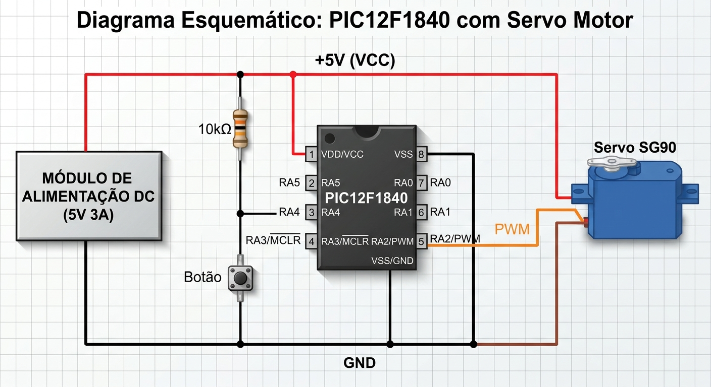
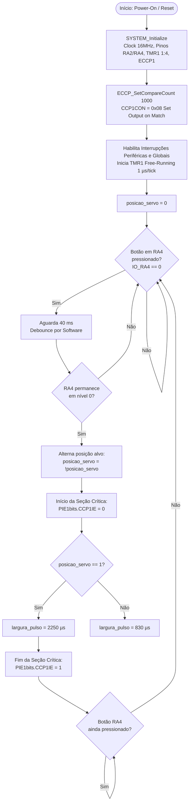
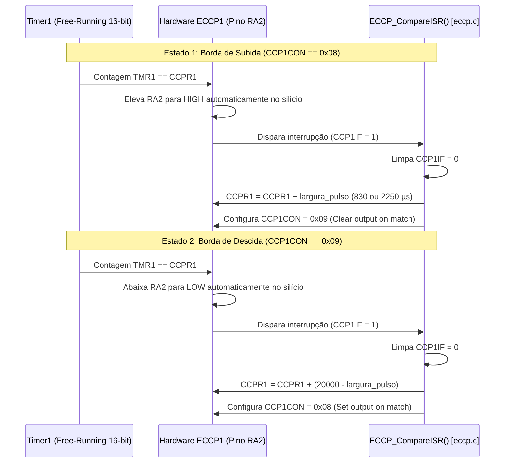

# Controle de Servomotor por Hardware Compare (`ECCP1` + `Timer1`) — PIC12F1840


Firmware embarcado de alta precisão em C para controle angular de servomotores utilizando o microcontrolador **Microchip PIC12F1840**. Em vez de utilizar PWM convencional baseado em Timer2 (que sofre com baixa resolução em frequências baixas como 50 Hz), este projeto implementa **modulação por largura de pulso baseada em eventos de comparação de hardware (`ECCP1` em modo Compare + `Timer1` de 16 bits)** operando a **16 MHz** (`FOSC/4 = 4 MHz`, prescaler `1:4`), alcançando resolução exata de **1 µs por tick** sem *jitter* de software.



---

## 📋 Sumário
- [Arquitetura e Cálculos de Temporização](#arquitetura-e-temporização)
- [Diagrama de Conexões (Hardware)](#diagrama-de-conexões-hardware)
- [Fluxograma de Execução e Máquina de Estados ISR](#fluxograma-de-execução-e-máquina-de-estados-isr)
- [Análise Técnica dos Drivers e Firmware](#análise-técnica-dos-drivers-e-firmware)
- [Estrutura do Repositório](#estrutura-do-repositório)
- [Como Compilar e Gravar](#como-compilar-e-gravar)
- [Autor](#autor)

---

## ⚙️ Arquitetura e Temporização

Servomotores padrão exigem um sinal periódico de **50 Hz** (período total de **20.000 µs**), onde a largura do pulso em nível lógico alto determina o ângulo do eixo.

### Engenharia do Clock (`1 tick = 1 µs`)
Com base nas configurações geradas em `clock.h` e `tmr1.c`:
* **Oscilador Principal (`_XTAL_FREQ`):** `16.000.000 Hz` (`16 MHz`)
* **Clock de Instrução (`TMR1CS = FOSC/4`):** `16 MHz / 4 = 4 MHz` (período de `0,25 µs`)
* **Prescaler do Timer1 (`T1CKPS = 1:4`):** `4 MHz / 4 = 1 MHz` (**1 tick = 1,00 µs**)
* **Alcance do Contador (16 bits):** `0` a `65.535 µs` (`65,536 ms`), comportando perfeitamente o ciclo de `20.000 µs` sem necessidade de recarga manual do Timer1 (*free-running counter*).

### Parâmetros Operacionais

| Parâmetro Técnico | Configuração / Registrador | Valor / Função |
| :--- | :--- | :--- |
| **Microcontrolador** | `PIC12F1840` | 8 pinos (PDIP/SOIC), núcleo Enhanced Mid-Range |
| **Saída PWM (Compare)** | Pino `RA2` (`CCP1`) | Saída digital controlada diretamente pelo hardware ECCP1 |
| **Entrada de Comando** | Pino `RA4` (`IO_RA4`) | Entrada digital com **Pull-Up interno (`WPUA4`)** ativo em `0` |
| **Período do Sinal** | `PERIODO_20MS` | `20.000 µs` (`50 Hz`) |
| **Pulso Posição 0°** | `PULSO_0_GRAUS` | `830 µs` (ajuste fino mecânico) |
| **Pulso Posição 180°** | `PULSO_180_GRAUS` | `2.250 µs` (ajuste fino mecânico) |
| **Tempo de Debounce** | `__delay_ms(40)` | Filtro contra trepidação mecânica da chave táctil em `RA4` |

---

## 🔌 Diagrama de Conexões (Hardware)

> **Nota de Engenharia:** Utilize uma fonte externa regulada de **5V** dedicada ao servomotor para suportar os picos de corrente de partida e torque, mantendo o **GND (`VSS`)** interligado ao do PIC12F1840.

```text
                        +5V (VDD)
                         │
                  ┌──────┴──────┐
                  │  PIC12F1840 │
                  │             │
         ┌────────┤ 1:VDD   VSS:8 ├────────┐
         │        │             │        │
         │   ┌────┤ 2:RA5   RA0:7 ├────┐   │ (ICSPDAT)
         │   │    │             │    │   │
   [Push-Button]  │ 3:RA4   RA1:6 │    │  GND (ICSPCLK)
   (WPUA4 Ativo)  │             │    │   │
         │   │    │ 4:RA3   RA2:5 ├──┐ │   │
         │   │    └─────────────┘  │ │   │
         │   │     (MCLR)          │ │   │
        GND  └─────────────────────┘ │   │
                                     │   │
                          Sinal PWM  │   │
                          (CCP1/RA2) ▼   │
                                ┌────────┴───┐
                                │ SERVOMOTOR │
                                │            │
                          +5V ──┤ VCC    GND ├── GND
                                └────────────┘
```

---

## 🔄 Fluxograma de Execução e Máquina de Estados ISR

O firmware divide as tarefas de forma assíncrona: o **Loop Principal (`main.c`)** gerencia a leitura da interface humana com *debounce* e proteção de seção crítica, enquanto a **Rotina de Interrupção (`ECCP_CompareISR` em `eccp.c`)** alterna os eventos de borda no silício.



### Máquina de Estados por Interrupção (`ECCP_CompareISR`)



---

## 🔍 Análise Técnica dos Drivers e Firmware

### 1. Geração de Pulso Livre de Jitter (`eccp.c`)
A alternância da saída ocorre no exato ciclo de clock em que o comparador de 16 bits detecta igualdade (`TMR1 == CCPR1`), antes mesmo de a CPU desviar para o vetor de interrupção:
* **Borda de Subida (`CCP1CON = 0x08`):** Quando `RA2` vai para nível alto, a ISR soma `largura_pulso` diretamente ao valor atual de `CCPR1` e muda o módulo para `0x09`.
* **Borda de Descida (`CCP1CON = 0x09`):** Quando `RA2` retorna para nível baixo, a ISR soma o tempo complementar (`20000 - largura_pulso`) a `CCPR1` e retorna o modo para `0x08`.
* **Aritmética Modular Natural:** Como tanto `TMR1` quanto `CCPR1` são registradores inteiros sem sinal de 16 bits (`uint16_t`), o transbordo (*overflow* em `65535 -> 0`) ocorre de maneira idêntica em ambos, dispensando qualquer reset manual do Timer1 e mantendo o período de `20.000 µs` rigorosamente constante.

### 2. Atomicidade e Proteção de Seção Crítica (`main.c`)
Por se tratar de uma arquitetura de **8 bits**, a atualização da variável global `volatile uint16_t largura_pulso` requer duas instruções de escrita na memória (byte baixo e byte alto).
```c
PIE1bits.CCP1IE = 0;
largura_pulso = (posicao_servo == 1) ? PULSO_180_GRAUS : PULSO_0_GRAUS;
PIE1bits.CCP1IE = 1;
```
O mascaramento temporário de `CCP1IE` impede que a interrupção ocorra entre a escrita dos dois bytes, eliminando o risco de leitura corrompida (*data tearing*) durante a transição entre `0°` e `180°`.

### 3. Tratamento de Entrada Digital (`pins.h` & `main.c`)
* **Pull-Up Interno (`WPUA4`):** Dispensa resistor externo no botão conectado entre `RA4` e `GND`.
* **Debounce + Trava de Liberação:** Após confirmar o nível lógico `0` por `40 ms`, o laço bloqueante `while (IO_RA4_GetValue() == 0);` garante que cada pressionamento execute exatamente uma comutação de ângulo.

---

## 📂 Estrutura do Repositório

```text
PIC12F1840_SERVOMOTOR_ECCP1/
├── README.md                             # Documentação técnica do projeto
└── SERVOMOTOR_ECCP1.X/
    ├── main.c                            # Loop principal, leitura de RA4 e seção crítica
    ├── SERVOMOTOR_ECCP1.mc3              # Arquivo de configuração visual do MCC
    ├── Makefile                          # Script de build gerado pelo MPLAB X IDE
    ├── mcc_generated_files/
    │   ├── compare/
    │   │   ├── eccp.h                    # Protótipos e union CCPR1_PERIOD_REG_T
    │   │   └── eccp.c                    # Inicialização ECCP1 e máquina de estados ISR
    │   ├── system/
    │   │   ├── clock.h                   # Definição _XTAL_FREQ (16 MHz)
    │   │   ├── config_bits.h             # Fuses do microcontrolador
    │   │   ├── interrupt.h               # Macros de controle GIE / PEIE
    │   │   ├── pins.h                    # Mapeamento e macros IO_RA2 (CCP1) e IO_RA4
    │   │   └── system.h                  # Header unificado de inicialização
    │   └── timer/
    │       └── tmr1.c                    # Driver Timer1 (FOSC/4, Prescaler 1:4)
    └── nbproject/                        # Metadados de configuração do MPLAB X
```

---

## 🚀 Como Compilar e Gravar

1. **Clone este repositório:**
   ```bash
   git clone https://github.com/robisonjunior/PIC12F1840_SERVOMOTOR_ECCP1.git
   ```
2. **Abra no MPLAB X IDE:**
   * Acesse **File → Open Project...** e selecione a pasta `SERVOMOTOR_ECCP1.X`.
3. **Calibração dos Limites Mecânicos (Opcional):**
   * Ajuste as constantes de largura de pulso em `main.c` e `eccp.c` conforme o modelo do seu servomotor:
     ```c
     #define PULSO_0_GRAUS    830    // Largura em µs para 0°
     #define PULSO_180_GRAUS  2250   // Largura em µs para 180°
     ```
4. **Compile e Grave no Hardware:**
   * Conecte um programador compatível (**PICkit 3, PICkit 4, PICkit 5 ou MPLAB SNAP**) aos pinos ICSP (`VDD`, `VSS`, `RA3/MCLR`, `RA0/ICSPDAT`, `RA1/ICSPCLK`) e clique em **Make and Program Device Main Project**.

---

## 👤 Autor

**Robison Egydio Lopes Junior (Junior Lopes)**  
GitHub: [@robisonjunior](https://github.com/robisonjunior)

